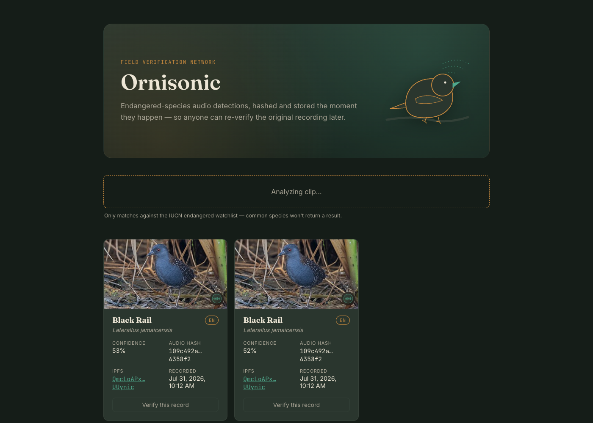
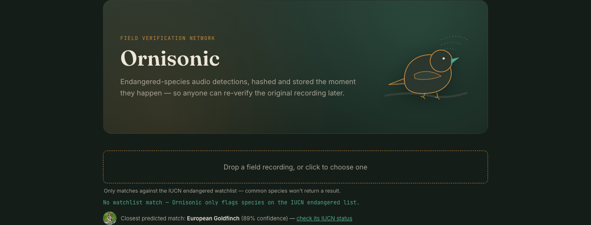

# Ornisonic

Live endangered-species audio detection, hashed and stored on IPFS, and anchored on-chain (Polygon Amoy testnet) for independently verifiable, tamper-proof records.

## Screenshots

**Watchlist match** — a Black Rail call gets classified, hashed, and pinned to IPFS:



**No match** — nothing on the watchlist, so the UI shows BirdNET's closest real-bird guess instead of storing anything:



## Architecture

```
Audio upload
   -> BirdNET classification (backend/classifier.py)
   -> Filter against endangered watchlist (watchlist/watchlist.json)
   -> On match:
        -> Upload audio to IPFS via Pinata (backend/ipfs_client.py)
        -> Hash audio, anchor record on-chain (backend/blockchain.py)
   -> Detection stored in Postgres (backend/db.py), queryable via FastAPI (backend/main.py)
   -> Anyone can re-hash the original audio and verify it against both the
      local record and the on-chain record (amoy.polygonscan.com)
```

The blockchain layer is optional and fails soft: if anchoring errors (no
funds, RPC down), the upload still succeeds and stores the IPFS/local record —
`onchain_error` is set on the response instead of a 500.

## Setup

### 1. Install dependencies
```bash
pip install -r requirements.txt
```

### 2. Get free API keys / accounts (all free tier)
- **Pinata** (IPFS storage): https://pinata.cloud -> API key + secret
- **IUCN Red List API** (species conservation status): https://apiv3.iucnredlist.org/api/v3/token -> free token

### 3. Set environment variables
Copy `.env.example` to `.env` and fill in:
```
PINATA_API_KEY=...
PINATA_SECRET_KEY=...
IUCN_TOKEN=...
```
`.env` is gitignored — never put real secrets in `.env.example` (that file is
committed as a template and should stay blank).

### 4. Build the watchlist
```bash
python watchlist/build_watchlist.py
```
This cross-references IUCN Red List status against BirdNET's supported species and writes `watchlist/watchlist.json`.

### 5. (Optional) Set up on-chain anchoring
Skip this if you just want IPFS/local hashing — the app works fully without it.

1. **Get a Polygon Amoy RPC URL.** Any public/free RPC endpoint works (e.g. a
   [dRPC](https://drpc.org) or [Alchemy](https://alchemy.com) Amoy endpoint).
2. **Create a wallet** and fund it with free testnet POL from an
   [Amoy faucet](https://faucet.polygon.technology/) — no real value, this
   never touches mainnet. A few faucets gate behind a mainnet-activity check;
   if you hit that, fund the wallet with a small amount of real ETH first to
   pass the check.
3. Add to `.env`:
   ```
   POLYGON_RPC_URL=...
   WALLET_PRIVATE_KEY=...
   ```
4. **Deploy the contract:**
   ```bash
   python scripts/deploy_contract.py
   ```
   This compiles `contracts/DetectionRegistry.sol`, prints the estimated gas
   cost before sending (so you can confirm it fits your balance), deploys to
   Amoy, and writes `backend/contract_abi.json`. Copy the printed address into
   `.env` as `CONTRACT_ADDRESS=...`.
5. Restart the backend. `/upload` will now anchor watchlist matches on-chain,
   and `/verify/{id}` will check the on-chain hash alongside the local one.

To make transactions to the contract decode as readable function calls
instead of raw calldata on the explorer, verify it (one-time, free, via the
["Verify Contract" flow](https://amoy.polygonscan.com/verifyContract) —
Solidity single file, matching compiler version, optimization off, MIT
license, no constructor arguments).

### 6. Start the database
Detections and the upload log are stored in Postgres. Locally, run Postgres 17
(the same version as production on Neon) with Docker:
```bash
docker compose up -d
```
Leave `DATABASE_URL` blank in `.env` and the backend connects to this local
database. In production, set `DATABASE_URL` to your Neon connection string;
nothing else changes. The backend creates its tables on startup from
`backend/schema.sql`. `docker compose down -v` wipes the local data.

To fill a fresh database with detections already anchored on-chain, run
`python -m scripts.backfill_from_chain`. It fetches each record's audio from
IPFS, checks it against the on-chain hash and inserts the row. It is read-only
on the chain and skips records already in the database.

### 7. Run the backend
```bash
uvicorn backend.main:app --reload
```

To run the production container image instead (built from `Dockerfile`,
connected to the compose database, served on the same port 8000):
```bash
docker compose --profile backend up --build
```

### 8. Test it
```bash
curl -X POST "http://localhost:8000/upload" -F "file=@sample.wav"
```

### 9. Run the frontend
With the backend running on port 8000:
```bash
cd frontend
npm install
npm run dev
```
Open http://localhost:5173 — the dev server proxies `/api/*` requests to the FastAPI backend, so no CORS setup is needed. Uploading a clip stores any endangered-species match and shows it as a card with its confidence, IPFS link, hash, and a verify button. If nothing on the watchlist matches, the UI instead shows BirdNET's closest real-bird prediction (with a thumbnail and a link to check its IUCN status) — nothing is stored in that case, since only watchlist matches get hashed and pinned to IPFS.

## Deployment

- **Backend:** Google Cloud Run (`us-east4`), built from `Dockerfile` by Cloud
  Build on every push to `main`. Secrets (`DATABASE_URL`, Pinata keys, wallet
  key) come from Secret Manager; `CONTRACT_ADDRESS` and `POLYGON_RPC_URL` are
  plain env vars. Scales to zero when idle, so the first request after a quiet
  spell is slow.
- **Database:** Neon Postgres 17. Fill a fresh one with
  `python -m scripts.backfill_from_chain`, with `DATABASE_URL` pointed at it.
- **Frontend:** Firebase Hosting. `frontend/.env.production` sets the backend
  URL for production builds; the backend allows the Firebase origins via
  `CORS_ORIGINS` (defaults to `ornisonic.web.app` / `ornisonic.firebaseapp.com`).
  Deploy with:
  ```bash
  npx firebase-tools deploy --only hosting   # builds frontend/ first
  ```

## Measured results

Real numbers pulled from this repo's actual runs, not estimates.

**Gas cost per anchor** — from the live Amoy contract's transaction receipts
(`0x52278aAc6BfE5fb72e8b526d3a75d9a75Fc6F463`, [verified source](https://amoy.polygonscan.com/address/0x52278aAc6BfE5fb72e8b526d3a75d9a75Fc6F463#code)):

| | Gas used | Cost (POL, testnet) |
|---|---|---|
| First anchor (cold storage write) | 249,838 | 0.0125 |
| Each subsequent anchor | 231,898 | 0.0116 |
| **Average** | **~235,500** | **~0.0118** |

**False-positive rate & recall, 0.5 vs. 0.7 threshold** — `classifier.py` uses
`min_confidence=0.5` instead of BirdNET's 0.7 default (see Notes below for
why). `scripts/eval_threshold.py` checks that tradeoff directly: 3 known
Black Rail clips as positives, 8 known non-watchlist clips (House Sparrow,
Grey Heron, American Robin, Northern Cardinal, Black-capped Chickadee,
European Starling, Blue Jay, Mourning Dove) as negatives.

| Threshold | Recall | False-positive rate |
|---|---|---|
| 0.7 (BirdNET default) | 0% (0/3) | 0% (0/8) |
| **0.5 (this app)** | **33% (1/3)** | **0% (0/8)** |

Lowering the threshold recovered a real detection the default would have
missed entirely, with no observed false positives. That said, n=11 is small —
zero false positives out of 8 negatives doesn't prove the true rate is zero,
just that it's low enough not to show up at this sample size. Re-run
`python -m scripts.eval_threshold` after adding more clips to
`eval_data/negatives/` for a tighter estimate; full per-file results land in
`eval_data/threshold_eval_results.json`.

**Clips processed** — tracked via `GET /stats`, backed by the `uploads` table
in Postgres. Check it live once the backend is running:
```bash
curl http://localhost:8000/stats
```

## Project layout
```
ornisonic/
├── watchlist/
│   └── build_watchlist.py     # IUCN + BirdNET overlap -> watchlist.json
├── contracts/
│   └── DetectionRegistry.sol  # on-chain detection registry
├── scripts/
│   ├── deploy_contract.py     # one-time contract deploy to Amoy
│   ├── backfill_from_chain.py # rebuild DB detections from on-chain records
│   └── eval_threshold.py      # FP-rate / recall eval at 0.5 vs 0.7 confidence
├── eval_data/
│   ├── negatives/              # gitignored: clips pulled for eval_threshold.py
│   └── threshold_eval_results.json
├── backend/
│   ├── main.py                # FastAPI app: /upload, /detections, /verify, /stats
│   ├── db.py                  # Postgres persistence (detections, upload log)
│   ├── schema.sql             # tables, applied on startup
│   ├── classifier.py          # BirdNET wrapper
│   ├── ipfs_client.py         # Pinata upload
│   ├── blockchain.py          # web3.py client: anchor/verify on-chain
│   └── contract_abi.json      # generated by deploy_contract.py
├── frontend/                  # React (Vite) dashboard
│   ├── src/
│   │   ├── App.jsx
│   │   ├── api.js
│   │   └── components/
│   └── package.json
├── docker-compose.yml         # local Postgres 17
├── requirements.txt
└── .env.example
```

## Notes
- Start with short (5-10s) test clips; BirdNET works best on that length.
- `classify_audio` filters BirdNET detections at `min_confidence=0.5` (`backend/classifier.py`). This is lower than BirdNET's usual 0.7 default because secretive, endangered species (e.g. Black Rail) tend to score lower than common, loud ones even on a real call — a stricter threshold was filtering out genuine detections of the exact species this app is meant to catch.
- Polygon Amoy testnet transactions are free (faucet-funded test POL, no real value); real Polygon mainnet costs are also low (roughly $0.01–0.02/tx as of mid-2026) if this ever moves to production.
